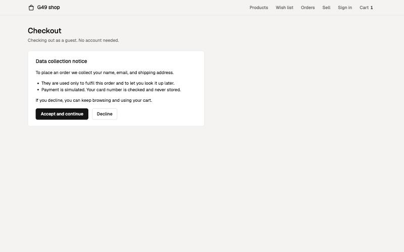
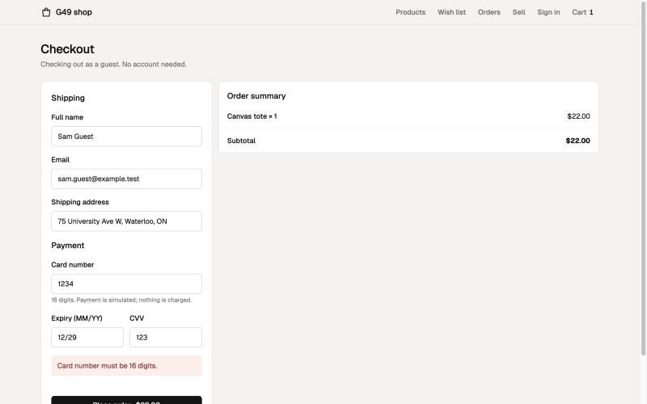
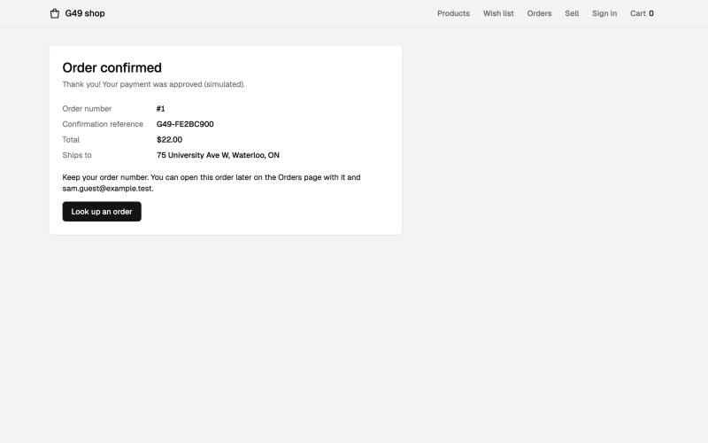
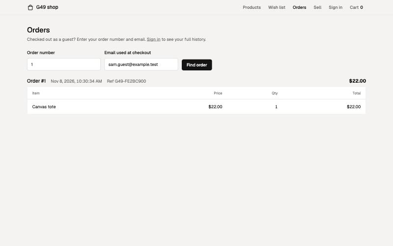
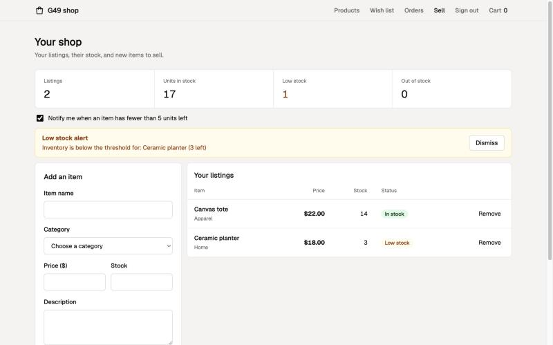
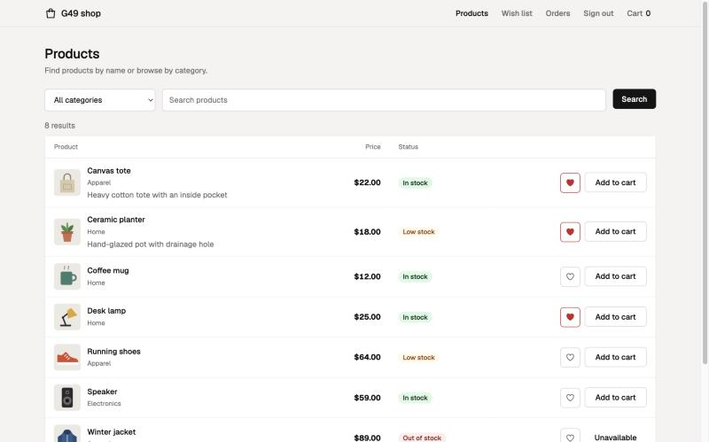
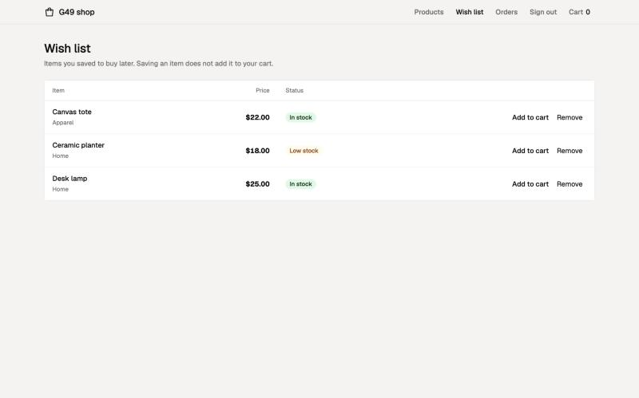

# Wilfrid Laurier University
## CP317A Group Project
### E-Commerce Application
### Sprint 02: Feature enhancement and integration

**Course code:** CP317A
**Project title:** E-Commerce Application
**Group ID:** Group G49
**Due date:** November 13, 2026

| Name | Role |
|---|---|
| Tai, Ethan | Scrum Master |
| **Tai, Austin** | **Product Owner** |
| Coufie, Stephen | Developer |

---

## Sprint Goal

Turn the Sprint 1 prototype into a store that can actually take orders. Shoppers can check out with shipping and simulated payment, with or without an account. Sellers can list items with an image and description and get low-stock alerts. Shoppers can save items to a wish list.

The following items were selected for this sprint:

- **CHK-2 (Checkout):** the cart from Sprint 1 had nowhere to go. Checkout completes the core buyer flow and creates the order record that tracking (TRK-1) and seller order updates (ORD-1) need in Sprint 3.
- **CHK-1 (Guest checkout):** first-time visitors can buy without signing up, which removes the biggest barrier to a first purchase.
- **INV-2 (Product listing, carried over):** image and description fields and the "pending validation" highlight were not built in Sprint 1. Buyers need them to decide what to buy.
- **USR-1 (Data collection opt-in, carried over):** checkout is the first place a guest gives us personal data, so the consent notice has to appear there.
- **INV-1 (Low stock alert):** checkout now lowers stock, so sellers need to know when an item is running out.
- **UI-2 (Wish list):** a small feature that reuses accounts and products, and gives shoppers a reason to come back.

---

## Sprint Backlog

CHK-1, CHK-2, INV-1 and UI-2 were already planned for Sprint 2 in the Milestone 02 backlog. INV-2 and USR-1 were carried over from Sprint 1 to finish their remaining tasks. The Excel Product Backlog shows Sprint = "Sprint 2" for all six stories, and the Sprint 2 sheet lists their tasks.

| Story ID & Title | Points | Priority | Assigned | Tasks | Status | Dependencies / integration |
|---|---|---|---|---|---|---|
| CHK-2 – Checkout | 5 | High | Ethan | CHK-2.1 Shipping and payment form, CHK-2.2 Backend validation of card (16 digits), expiry (future MM/YY) and CVV, CHK-2.3 Store a confirmation reference instead of the card number, CHK-2.4 Confirmation page | Done | Uses the Sprint 1 session cart and stock check; reduces stock, which feeds INV-1 |
| CHK-1 – Guest Checkout | 5 | High | Ethan | CHK-1.1 Orders without an account (email stored on the order), CHK-1.2 Database migration so `orders.account_id` can be empty, CHK-1.3 Order lookup by order number and email | Done | Depends on CHK-2's checkout form and on USR-1's consent check |
| INV-2 – Product Listing *(carried over)* | 8 | High | Stephen | INV-2.4 Description and image link fields with backend validation, INV-2.5 "Pending validation" highlight until the backend saves the listing, INV-2.6 Show image and description on the product page | Done | Extends the Sprint 1 seller dashboard and listing endpoint |
| USR-1 – Data Collection Opt-In *(carried over)* | 1 | High | Stephen | USR-1.4 Consent notice at guest checkout naming the data and its purpose; declining keeps search and cart available | Done | Reuses the Sprint 1 consent endpoint; blocks CHK-1 until accepted |
| INV-1 – Low Stock Alert | 3 | Medium | Austin | INV-1.1 Opt-in setting saved on the seller account, INV-1.2 Alert banner naming items with fewer than 5 units | Done | Reads stock that CHK-2 reduces |
| UI-2 – Wish List | 2 | Medium | Austin | UI-2.1 `wishlist` table and endpoints, UI-2.2 Heart button on products, UI-2.3 Wish list page with add-to-cart and remove | Done | Uses Sprint 1 accounts and products; kept separate from the cart |

Sprint 2 total: 24 story points, all Done.

---

## Implementation Progress

Progress was made on both the backend and frontend.

**Backend (Flask + SQLite)**
- Checkout endpoint accepts shipping and payment details, validates them, and stores the order with a confirmation reference. The card number is never stored.
- Orders can be placed without an account. Guests look up an order later with its number and email.
- Automatic database migration: databases from Sprint 1 are upgraded on startup (new columns added, guest orders allowed) without losing existing orders.
- Listings accept a description and an image link, validated by the backend.
- Low-stock alert opt-in saved on the seller's account.
- Wish list table and endpoints (add, list, remove).

**Frontend (Angular)**
- New Checkout page with a shipping form, simulated payment form, order summary and confirmation screen.
- Consent notice shown at guest checkout before any personal data is entered.
- Orders page: guests can look up an order by number and email; signed-in users see their history with the confirmation reference.
- Seller dashboard: description and image fields, "Pending validation" highlight on new listings, low-stock alert opt-in.
- Product page shows listing images and descriptions, with a heart button to save items.
- New Wish List page, linked from the header.

### Screenshots

**Consent notice at guest checkout (USR-1):**



**Checkout form rejecting an invalid card (CHK-2):**



**Order confirmation (CHK-2, CHK-1):**



**Guest order lookup (CHK-1):**



**Seller dashboard with the low-stock alert (INV-1, INV-2):**



**Product page with images, descriptions and saved hearts (INV-2, UI-2):**



**Wish list page (UI-2):**



### Code snippets

**Simulated payment validation (backend):**
```python
card = str(data.get("card_number", "")).replace(" ", "")
if not (card.isdigit() and len(card) == 16):
    return "Card number must be 16 digits."
...
if not valid_month or expiry < (today.year, today.month):
    return "Enter a future expiry date as MM/YY."
```

**Order keeps a reference, never the card number:**
```python
# Payment is simulated: keep a confirmation reference, never the card number.
reference = "G49-" + secrets.token_hex(4).upper()
cursor = db.execute(
    """
    INSERT INTO orders (account_id, total, email, shipping_address, reference)
    VALUES (?, ?, ?, ?, ?)
    """,
    (user["id"] if user else None, total, email, address, reference),
)
```

**Guest checkout requires consent first (USR-1 + CHK-1):**
```python
if not user and session.get("consent") != "accepted":
    return "Accept the data notice before checking out as a guest."
```

**Pending validation highlight on new listings (Angular):**
```ts
// INV-2: show the item highlighted as pending until the backend validates and saves it.
const tempId = -Date.now();
this.listings.update((list) => [{ ...data, id: tempId, pending: true }, ...list]);
this.api.addSellerListing(data).subscribe({
  next: (res) => this.listings.update((list) => list.map((l) => (l.id === tempId ? res.listing : l))),
  error: (err) => this.listings.update((list) => list.filter((l) => l.id !== tempId)),
});
```

### Integration between new and existing modules

- **Checkout ↔ cart:** checkout reads the same session cart from Sprint 1, re-checks stock, and empties the cart after the order is placed.
- **Checkout ↔ consent:** guest checkout reuses the Sprint 1 consent endpoint. The same consent flag gates account creation and guest checkout.
- **Checkout ↔ seller alerts:** placing an order lowers stock, and the seller's low-stock banner reads that stock.
- **Wish list ↔ accounts and products:** the wish list links signed-in accounts to existing products. Removing a listing also removes it from wish lists.
- **Database:** new columns are added on startup and Sprint 1 data is kept, so teammates did not have to delete their local databases.

### Technical Issues

| Issue | Resolution |
|---|---|
| The Sprint 1 `orders` table required an account, so guest orders failed | On startup, the backend detects the old table and rebuilds it with the account optional, copying existing orders. A unit test covers this. |
| Storing card details would be a privacy and security risk | Payment is simulated. The card is only validated; the order stores a random confirmation reference instead. |
| Order times showed 5 hours off | SQLite stores UTC without a time zone. The API now marks the time as UTC so the browser shows local time. |
| Guests had no way to see an order after closing the page | Added an order lookup using the order number and the email entered at checkout. |
| The Proceed to checkout button overflowed its box after it became a link | Fixed the button styles in the cart summary. |

### Items deferred to future sprints
- Live order tracking (TRK-1) and seller order status updates (ORD-1), Sprint 3
- Verified reviews (REV-1), Sprint 3
- Purchase frequency summary (REP-1), Sprint 3
- Account security: lock-out and CAPTCHA (USR-3), Sprint 3
- Image upload (listings currently take an image link)

---

## Demo Video

[TEAM: link to the 1–3 minute narrated video (YouTube unlisted, OneDrive or Google Drive with access enabled)]

Suggested order: guest adds an item → checkout → consent notice → invalid card error → order confirmed → order lookup → seller adds a listing with image and description → low-stock alert → shopper saves an item to the wish list.

---

## Testing and Review

We tested in two ways: automated unit tests for the backend, and manual test cases run in the browser against the running app. Each manual case lists the input, the expected result, the actual result and pass or fail. We tested failure cases as well as the normal path.

### Manual test cases

Run on November 12, 2026 with the Angular frontend and Flask backend on a fresh database. A few steps can't be done from the page (for example, sending a quantity of 0); for those we sent the request straight to the backend, and the table says so.

**Search and cart (Sprint 1 features, re-tested)**

| ID | Story | Test (steps / input) | Expected | Actual | Result |
|---|---|---|---|---|---|
| T1 | UI-1 | Search for "zzqx" (matches nothing) | "0 results" and a message, not a blank page | "0 results" and "No products found. Try a different search." | Pass |
| T2 | UI-1 | Search for "100%" | % treated as a normal character, so no matches (not every product) | 0 results | Pass |
| T3 | UI-1 | Search for "apparel" (a category name) | Apparel products | Running shoes and Winter jacket | Pass |
| T4 | UI-3 | Try to add Winter jacket (0 in stock) | Can't be added | Button shows "Unavailable" | Pass |
| T5 | UI-3 | Running shoes (4 in stock): press + five times in the cart | Quantity stops at 4 | Stopped at 4, "Max available" shown, + turned off | Pass |
| T6 | UI-3 | Lower the quantity to 0 | Item can't drop below 1 on the page (Remove takes it out); a quantity of 0 removes it | − turned off at 1. Quantity 0 sent to the backend: "Item removed from the cart.", cart empty | Pass |

**Accounts and data opt-in**

| ID | Story | Test (steps / input) | Expected | Actual | Result |
|---|---|---|---|---|---|
| T7 | USR-1 | Sign-up page: click Decline on the data notice | No account; search and cart still work | Returned to Products with all 6 items; cart still usable | Pass |
| T8 | USR-2 | Sign up with passwords that don't match | Error, no account | "Passwords do not match." | Pass |
| T9 | USR-2 | Sign up with valid details | Account created | Account created, sent to the Sign in page | Pass |
| T10 | USR-2 | Sign up again with the same email in different capitals (Shopper@Test.local) | Refused as a duplicate | "An account with that email already exists." | Pass |
| T11 | USR-2 | Sign in with a wrong password | Refused | "Email or password does not match." | Pass |
| T12 | USR-2 | Sign in with the right password | Signed in | Products page, header shows Sign out | Pass |

**Checkout and guest checkout**

| ID | Story | Test (steps / input) | Expected | Actual | Result |
|---|---|---|---|---|---|
| T13 | USR-1, CHK-1 | Guest who has not accepted the notice opens checkout and tries to order | Notice shown instead of the form; order refused | Only the data notice shown. Order sent to the backend refused: "Accept the data notice before checking out as a guest." | Pass |
| T14 | USR-1 | Click Decline at checkout | Checkout unavailable; cart kept | "You declined, so checkout is unavailable. You can accept at any time." Cart still had its item | Pass |
| T15 | CHK-2 | Card number with 15 digits | Error, no order | "Card number must be 16 digits." | Pass |
| T16 | CHK-2 | Expiry date 01/24 (in the past) | Error, no order | "Enter a future expiry date as MM/YY." | Pass |
| T17 | CHK-1, CHK-2 | Guest order with a 16-digit card and expiry 12/28 | Confirmation with order number; stock goes down; cart empties; card number not stored | Order #1 with reference G49-2058A406. Running shoes stock 4 → 3, cart empty. Card number not found anywhere in the database | Pass |
| T18 | CHK-1 | Look up order #1 with a different email | Order not shown | "No order matches that number and email." | Pass |
| T19 | CHK-1 | Look up order #1 with the email used at checkout | Order shown | Order #1 shown with its items and reference | Pass |
| T20 | CHK-2 | Signed-in shopper checks out | Name and email filled in; order appears in history | Name and email pre-filled. Order #2 listed under "Your order history"; guest order #1 not shown | Pass |

**Wish list**

| ID | Story | Test (steps / input) | Expected | Actual | Result |
|---|---|---|---|---|---|
| T21 | UI-2 | Signed in, click the heart on Desk lamp | Saved to the wish list | Heart changed to "Remove from wish list"; Wish list page shows Desk lamp | Pass |
| T22 | UI-2 | Add Desk lamp a second time (sent to the backend) | Still one copy | One Desk lamp in the list | Pass |
| T23 | UI-2 | Guest opens the Wish list page | Asked to sign in | Sent to Sign in; backend answers 401 "Sign in to use the wish list." | Pass |
| T24 | UI-2 | Sign out, then sign back in | Wish list kept | Desk lamp still saved | Pass |

**Seller listings and low-stock alerts**

| ID | Story | Test (steps / input) | Expected | Actual | Result |
|---|---|---|---|---|---|
| T25 | INV-2 | Guest opens the seller page | Asked to sign in | Sent to Sign in | Pass |
| T26 | INV-2 | Signed-in shopper opens the seller page | Blocked | Sent to the Sign in page; backend answers 403. No message says why (see issues below) | Pass |
| T27 | INV-2 | Add a listing with price 0 | Error, not saved | "Enter a name, a category, a price above 0, and a whole-number stock." | Pass |
| T28 | INV-2 | Image link starting with ftp:// | Error, not saved | "Image link must start with http:// or https://." | Pass |
| T29 | INV-2 | Leave the description empty | Error, not saved | "Enter a description." | Pass |
| T30 | INV-2 | Add a valid listing (Canvas tote, $22, 10 in stock) | Shown as pending until saved | "Pending validation" shown, then "In stock" once the backend saved it | Pass |
| T31 | INV-2 | As a shopper, search for "planter" (a seller listing) | Listing found with its image and description | Ceramic planter shown with its picture and "Hand-glazed pot for small plants." | Pass |
| T32 | INV-1 | Alerts off, Ceramic planter has 3 left | No banner | No banner | Pass |
| T33 | INV-1 | Turn on "Notify me when an item has fewer than 5 units left" | Banner names only items under 5 | "Inventory is below the threshold for: Ceramic planter (3 left)". Canvas tote (10) not listed | Pass |
| T34 | INV-1 | Reload the seller page | Setting kept | Box still ticked, banner still shown | Pass |

**Result: 34 of 34 manual cases passed.**

**Issues found during testing**
- T26: a signed-in shopper who opens the seller page is sent to the Sign in page with no explanation. Access is correctly blocked, but the page should say "Seller features need a seller account." Added to the backlog for Sprint 3.
- Two items sold out at the same moment can't be clicked through by hand. That case is covered by the unit test below ("an order is fully cancelled if an item runs out of stock").

### Automated unit tests

`sprint1/test_app.py` (Python unittest) runs against a fresh temporary database. **15 tests (6 from Sprint 1, 9 new), all 15 pass** (`python3 -m unittest test_app`, run November 12, 2026). Like the manual cases, they cover the failure paths as well as the normal path:
- Guest checkout: blocked without consent, rejects an invalid card and an expired date, then succeeds; stock goes down; the card number is not stored; order lookup works only with the matching email
- A signed-in shopper's order appears in their history
- Listings: need a description, reject a bad image link, are searchable with description and image; the low-stock setting is saved
- Wish list: guests get 401; adding twice keeps one copy; kept after signing out and in; remove works
- A Sprint 1 database is upgraded without losing orders
- An order is fully cancelled if an item runs out of stock
- Bad input (wrong JSON shape, NaN price, oversized numbers, four-digit expiry year) gets an error instead of a crash
- Keyword search also matches categories and treats `%` as a normal character
- Starter products get their pictures without changing seller listings
- The 6 Sprint 1 tests still pass (search, cart limit, consent, roles)

### Product Owner review

**Product Owner review:** Austin Tai (Product Owner) reviewed the six Sprint 2 stories in the running app on November 12, 2026 and accepted all of them. No changes were requested.

| Story | Acceptance criteria | Test cases | Result | PO acceptance |
|---|---|---|---|---|
| CHK-2 Checkout | Shopper inputs valid shipping and payment data, places the order, receives an order confirmation message, and an order record is created | T15–T17, T20 | Pass | Accepted |
| CHK-1 Guest Checkout | First-time visitor can complete a checkout without registering an account | T13, T17–T19 | Pass | Accepted |
| INV-2 Product Listing | Seller can list an item with an image and description, and it appears and is searchable on the marketplace; pending highlight shown on listing | T25–T31 | Pass | Accepted |
| USR-1 Data Collection Opt-In | Notice at checkout names the data and purpose; declining does not block search or the cart | T7, T13, T14 | Pass | Accepted |
| INV-1 Low Stock Alert | Seller who opted in sees an alert naming items with fewer than 5 units | T32–T34 | Pass | Accepted |
| UI-2 Wish List | Shopper can click the heart on a product and the item is saved to a personal wish list | T21–T24 | Pass | Accepted |
